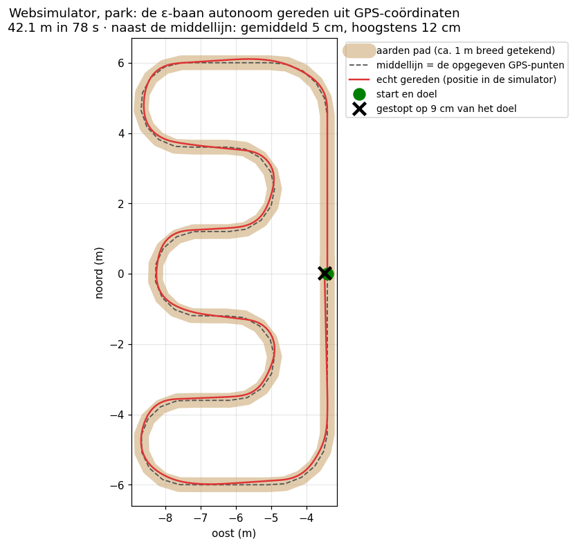

# Jaguar-Project

Software voor de Dr Robot Jaguar 4x4: rijden op afstand, op centimeters, een route volgen naar GPS-coördinaten, obstakels zien met de camera, live meekijken en elke rit achteraf analyseren.

**Demo's:** [video van de rit](docs/demo/robot_video_simulatie.mp4) · [video van de analyse](docs/demo/robot_analyse_video.mp4)

## Wat je nodig hebt

| Wat | Detail |
|---|---|
| Robot | Jaguar 4x4 op het wifi `DriJaguar`, besturing op `192.168.0.60:10001` (TCP) |
| Camera | Axis op het robot, `192.168.0.65:8081` (alleen nodig voor camerabeeld en obstakels) |
| Laptop | Python 3.11, `pip install matplotlib` (analyse), `pip install opencv-python numpy` (obstakels) |
| Optioneel | Docker voor Grafana (`grafana/`) |

Alle commando's draai je vanuit de projectmap: `python -m jaguar.<map>.<bestand>`.

## Hoe het geheel werkt

```
robot ──TCP-tekstregels──> kern/robot.py ──> odometrie.py (waar ben ik?)
                               │                   │
                               │                   └──> rijscripts sturen de motoren (rijden/)
                               ├──> live pagina http://127.0.0.1:8765  (+ MQTT → Grafana)
                               └──> ritten/rit_<datum>.csv ──> analyse/rit.py ──> dashboard/dashboard.html
```

De robot zelf rekent niets uit: hij stuurt ruwe metingen en voert motoropdrachten uit. Alles (positie, sturen, veiligheid) gebeurt op de laptop.

## Wat de robot stuurt

| Regel | Hoe vaak | Inhoud |
|---|---|---|
| `#..,GYRO,..,ACC,..` | 50 Hz | IMU: draaisnelheid (gyro) en versnelling |
| `MM0 C=..` / `MM1 C=..` | 5 Hz | tellers van de 4 wielen (1 puls = 2,8 mm) |
| `MM0 V=..` | 5 Hz | batterijspanning |
| `$GPRMC,..` | 5 Hz | GPS: breedte, lengte, snelheid en koers over de grond |
| `MM0 FF=..` | 1 Hz | E-Stop actief of niet |

De laptop stuurt elke 100 ms een PING en het vermogen per kant (`MMW !M <links> <-rechts>`, -1000..1000). Komt er geen PING meer, dan stopt het robot vanzelf (watchdog).

## Waar is het robot? (odometrie)

[kern/odometrie.py](jaguar/kern/odometrie.py), live tijdens het rijden én achteraf in de analyse:

- **Afstand:** gemiddelde van de 4 wielen. Een wiel dat afwijkt van de rest, of van wat de accelerometer voorspelt, slipt en telt niet.
- **Koers:** de gyro. Het kompas is onbruikbaar door de motoren.
- **Alle wielen slippen:** de accelerometer overbrugt hoogstens 0,6 s; daarna is de afstand "onzeker" en stopt het robot na 1 s.
- **Grens:** slippen alle vier de wielen evenveel (gras, zand), dan ziet niemand het.

## Rijden

| Script | Wat het doet |
|---|---|
| `rijden.rechtdoor --distance 2` | rechtdoor in één beweging: optrekken, remmen, vermogen uit zodat het uitrollen precies op het doel eindigt (fout ≤ 10 mm) |
| `rijden.heen_en_terug --distance 1.5` | heen en terug |
| `rijden.parcours v:2 l:90 v:2` | stappen vooruit/achteruit en draaien ter plaatse op de gyro (tot op 1°) |
| `rijden.gps_route <lat,lon> ...` | een route van GPS-punten (zie hieronder) |
| `rijden.bediening` | alles vanuit de browser (zie hieronder) |

- **Rechtdoor blijven:** de afwijking van de lijn geeft een gewenste koers, een PID op de gyro zet die om in een verschil links/rechts.
- **Een bocht of route in één beweging** (`Jaguar.volg`): elke 0,05 s mikt het robot op de richting van het pad 0,15 s verderop, plus 100° per meter naast de lijn (hoogstens 25°), en remt voor bochten.
- **Bijleren:** uitrollen, vermogen→snelheid en draaistoten worden na elke rit bewaard in `config/leerwaarden.json`.

## Naar GPS-coördinaten

```powershell
python -m jaguar.rijden.gps_route --punten-bestand testdata/websim_epsilon_baan.txt --richting 0 --vloeiend
python -m jaguar.rijden.gps_route 50.8400000,4.3200000 50.8400449,4.3200000 --richting 0 --droog   # alleen het plan
```

1. **Punt 1 = nulpunt.** Elke coördinaat wordt (oost, noord) in meter rond punt 1 ([navigatie/gps.py](jaguar/navigatie/gps.py), `Lokaal`).
2. **Het noorden:** `--richting` (0 = noord, 90 = oost), of het robot rijdt eerst 6 m rechtdoor en haalt het noorden uit het GPS-spoor.
3. **Draaien naar het robotstelsel:** (oost, noord) wordt (vooruit, links), de hoeken worden afgerond, een punt om de 2 cm.
4. **Rijden op wielen en gyro.** De GPS (3 tot 15 m fout) controleert het noorden en de schaal (slip), en verbetert de positie pas als hij beter is dan de wielen.

### Hoe weten we waar het robot is aangekomen?

Aan de robot of zijn API moest niets veranderen: de GPS-ontvanger stuurt zelf al `$GPRMC`-zinnen, en `navigatie/gps.py` leest ze. Na de rit geeft `gps_route` twee posities:

- **Volgens wielen en gyro:** de positie van de odometrie, met het noorden en punt 1 terug omgerekend naar breedte/lengte (`robot_naar_enu` + `Lokaal.naar_ll`). Dit is de nauwkeurigste.
- **Volgens de GPS:** het gemiddelde van de laatste 2 s GPRMC, met de afstand tot het laatste punt.

In de websimulator meldt de brug (`testen/api_brug.py`) bij het sluiten ook waar het robot **echt** staat in de simulatie.

## Bediening vanuit de browser

`python -m jaguar.rijden.bediening` opent http://127.0.0.1:8765:

- **Rijden:** ontwerper met een raster (Binnen) of een kaart (Buiten). Je tekent de route, bekijkt de simulatie en start.
- **Pauze** (of P), **Terug naar start**, **STOP** (of spatie).
- **Handmatig:** pijltjes/WASD of een gamepad. Ontvangt het robot 0,4 s niets, dan stopt het.
- **Analyse:** het dashboard van de rit die net gereden is.

Andere apparaten op het wifi kunnen meekijken en STOP drukken; starten kan alleen op de laptop.

## Camera en obstakels

[camera/obstakel.py](jaguar/camera/obstakel.py), standaard uit (aan via Opties → Camera / Obstakels):

- **Zien:** in de middelste strook van het beeld zoekt OpenCV van onder naar boven de eerste plotse kleursprong (de voet van een obstakel).
- **Afstand:** de camera staat vast, dus elke beeldlijn is een afstand op de vloer (`d = k / (y − y_horizon)`), eenmalig gekalibreerd tegen een muur op 1, 2 en 3 m.
- **Reageren:** vooruit afremmen en stoppen op 0,4 m. Een parcours wacht tot 4 s en rijdt er dan omheen. Geen beeld gedurende 1,5 s = stoppen.
- **Grens:** alleen vooruit; glas, een muur in de kleur van de vloer of duisternis ziet hij niet.

## Veiligheid

Het robot stopt vanzelf bij:

- meer dan 35° kantelen;
- 1,5 s vol vermogen zonder vooruit te komen (vastgelopen);
- wielen die 1 s draaien zonder dat het robot rijdt;
- meer dan 1 m naast de route;
- batterij: onder 21,6 V terug naar de start, onder 21,0 V stoppen.

De fysieke noodstop blijft de echte noodstop.

## Na de rit: analyse en dashboard

- Elke rit wordt een CSV in `ritten/` (tijd, fase, vermogen, ruwe regel).
- `python -m jaguar.analyse.rit` rekent alles opnieuw uit en werkt `dashboard/dashboard.html` bij: afstand, slip, gebeurtenissen, de route op ware schaal en een 3D-weergave.
- Live in Grafana: voeg `--mqtt` toe (opzetten: [grafana/](grafana/README.md)).

## Kalibreren

| Wat | Commando |
|---|---|
| Wielstraal (rolmeter) | `python -m jaguar.kalibratie.kalibreer 2.968` na 3 m rijden |
| Afstand met de GPS | `python -m jaguar.kalibratie.gps_afstand --distance 20` |
| Gyroschaal | `python -m jaguar.kalibratie.test_sondewiel draai --turns 2` |
| Camera | Opties → Obstakels → Kalibreren… |

## Zonder robot

| Wat | Commando |
|---|---|
| Gesimuleerde robot (met GPS, slip, vertraging) | `python -m jaguar.testen.sim_robot`, dan rijden met `--ip 127.0.0.1` |
| Websimulator robotics.dinno.be | `.\start_websim.ps1` (zie [testen/](jaguar/testen/README.md)) |
| Tests | `python -m jaguar.testen.test_rijden` (~4 min), `test_gps_route` (~6 min), `test_bediening` (~2 min) |

## De ε-baan in de websimulator (lokale API)



De simulator van robotics.dinno.be heeft een Jaguar 4x4 in een park met een aarden ε-pad (bord 12). De **Training API** ([github.com/mdequanter/robotSimulatorAPI](https://github.com/mdequanter/robotSimulatorAPI), `node server.mjs`) draait diezelfde simulator op de eigen pc, in Chrome, achter een HTTP-API op `localhost:8780`.

```text
gps_route.py ──TCP 127.0.0.1:10001──> testen/api_brug.py ──HTTP localhost:8780──> server.mjs ──> simulator
```

Onze code weet niet dat het een simulator is: de brug doet zich voor als het echte robot.

### Zo rijd je de baan

Eenmalig: `setx ROBOTSIM_KEY "rsk_..."` (de sleutel van je account; nooit in een bestand van het project).

**Terminal A**: simulator en brug starten.

```powershell
cd C:\Dev\Jaguar-Project
Set-ExecutionPolicy -Scope Process Bypass
.\start_websim.ps1 -Plaats "-3.4,0,90"
```

`-Plaats "x,z,koers"` zet het robot neer: 3,4 m ten westen van de oorsprong, met de neus naar het noorden (in de simulator is 0° = oost, 90° = noord). Daar begint het aarden pad, en daar begint ook het eerste GPS-punt van de route. Staat het robot ergens anders, dan rijdt het de baan verschoven.

**Terminal B**: de route rijden en daarna analyseren.

```powershell
cd C:\Dev\Jaguar-Project
$env:JAGUAR_WIELSTRAAL = "0.135"
python -m jaguar.rijden.gps_route --punten-bestand testdata/websim_epsilon_baan.txt --richting 0 --vloeiend --ip 127.0.0.1
python -m jaguar.analyse.rit
```

| Optie | Betekenis |
|---|---|
| `JAGUAR_WIELSTRAAL=0.135` | de wielstraal van de simulator; het echte robot is gekalibreerd op 0,1336 m |
| `--punten-bestand` | [testdata/websim_epsilon_baan.txt](testdata/websim_epsilon_baan.txt): 87 GPS-punten (breedte,lengte), om de 0,5 m langs de middellijn van het pad |
| `--richting 0` | de kompaskoers bij de start (0 = noord). De GPS zegt waar het robot is, niet waar het naartoe kijkt. Dit is hetzelfde noorden als de 90 van `-Plaats`, in een andere conventie |
| `--vloeiend` | alle punten als één vloeiende lijn, zonder stoppen; zonder deze optie rijdt het punt per punt en draait het ter plaatse in elke hoek |
| `--ip 127.0.0.1` | verbinden met de brug op deze pc; voor het echte robot is dat `192.168.0.60` (de standaard) |

Leg je het robot ergens anders neer, pas dan `-Plaats` en `--richting` samen aan.

### Hoe het robot het pad volgt

1. **Coördinaten naar meters:** het eerste punt is (0, 0); elk punt wordt (oost, noord) in meter, en met `--richting` (vooruit, links) voor het robot.
2. **Eén pad:** de hoeken worden afgerond en de lijn krijgt een punt om de 2 cm.
3. **Waar ben ik:** afstand uit de 4 wielen, koers uit de gyro (geen GPS).
4. **Sturen, elke 0,05 s:** het dichtste punt op het pad zoeken; als doelkoers de richting van het pad 0,15 s verderop nemen, plus 100° per meter naast de lijn (hoogstens 25°); de buitenste wielen meer vermogen geven in een bocht; vertragen voor bochten en remmen naar het laatste punt.
5. **De GPS** kijkt alleen mee: na de rit zegt hij of het noorden en de afstand klopten.

### Waar het robot is, drie bronnen

| Bron | Komt van | Ziet onze code het? | Waarvoor |
|---|---|---|---|
| GPS | het veld `gps` van de simulator, door de brug omgezet naar `$GPRMC` | ja | het noorden en de afstand controleren |
| Wielen en gyro | encoders en IMU van de simulator | ja | sturen |
| Echte positie | het veld `pose` van de simulator, door de brug bewaard in `ritten/websim_spoor.csv` | nee | achteraf meten hoe ver het robot naast de lijn reed |

### De analyse

`python -m jaguar.analyse.rit` neemt de nieuwste CSV in `ritten/`:

1. speelt alle ruwe regels opnieuw af door dezelfde odometrie als tijdens het rijden;
2. tekent het gereden spoor uit afstand en gyrokoers, naast het gevraagde pad (dat staat in de CSV als `PADPUNTEN`);
3. meet voor elk punt de afstand tot de lijn: gemiddeld, hoogstens, en hoe ver het van het eindpunt stopte;
4. schrijft `ritten/<rit>_analyse.json` en werkt `dashboard/dashboard.html` bij (figuur "Route in één beweging", slip, gebeurtenissen, 3D).

Dat dashboard toont waar het robot **denkt** te zijn. De figuur bovenaan deze sectie (`docs/websimulator/teken_baan.py`) toont de **echte** positie uit `websim_spoor.csv`.

**Wat de brug doet** ([testen/api_brug.py](jaguar/testen/api_brug.py)):

- vraagt de simulator 50 stappen van 0,02 s per seconde, in echte tijd;
- geeft onze commando's (`PING`, `MMW !M ..`) bij elke stap mee als `{"tcp": [...]}`;
- maakt van elke waarneming de regels die het echte robot stuurt: IMU (50 Hz), encoders, batterij en `$GPRMC` (5 Hz), E-Stop (1 Hz);
- keert het teken van de gyro-Y-as om: die draait in de simulator andersom dan op het echte robot.

**Wat er aan de API veranderd is: niets.** De lokale kopie `C:\Dev\robotSimulatorAPI` is gelijk aan GitHub (`main`, commit `585e8f6`), zonder eigen wijzigingen. We gebruiken alleen bestaande aanroepen: `POST /api/envs` (robot `jaguar`, wereld `park`), `POST /api/envs/{id}/step` (acties `tcp` en `place`) en `GET /api/envs/{id}/frame`. Alles wat nodig was om er een Jaguar van te maken, zit aan onze kant in `api_brug.py`, plus de wielstraal van de simulator (0,135 m).

**Resultaat** (rit van 19 november):

| | Naast de middellijn gemiddeld | Hoogstens | Gestopt van het doel |
|---|---|---|---|
| Websimulator, ε-baan (42,1 m) | 4,9 cm | 12,3 cm | 8,5 cm |
| sim_robot, zelfde baan | 3,9 cm | 11,6 cm | 1 cm |

## Mappen

```
jaguar/kern/        robot.py (verbinding, motoren, veiligheid) en odometrie.py
jaguar/rijden/      rechtdoor, heen_en_terug, parcours, gps_route, bediening
jaguar/navigatie/   GPS lezen, coördinaten ↔ meters, het noorden, routes
jaguar/camera/      obstakels zien
jaguar/live/        live pagina en ontwerper
jaguar/analyse/     rit.py: analyse en dashboard
jaguar/kalibratie/  wielstraal, gyroschaal, driver
jaguar/testen/      nep- en simulatierobot, brug naar de websimulator, tests
ritten/  dashboard/  config/  grafana/  testdata/  docs/
```

Elke map heeft een eigen README. De vroegere uitgebreide uitleg staat in [docs/uitgebreid.md](docs/uitgebreid.md).
